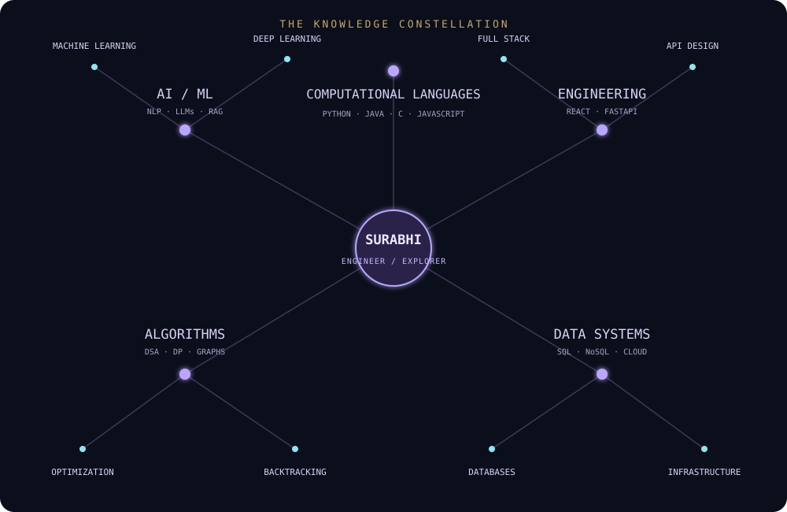
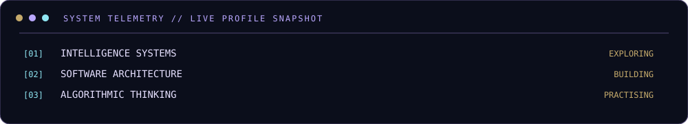

 

PERSONAL RESEARCH ARCHIVE · VOL. 001 · CONTINUOUSLY EVOLVING

---

<b>⌘ NAVIGATE THE ARCHIVE</b> &nbsp;·&nbsp; OPEN INDEX

| COORDINATE | CHAPTER | CONTENT |
|:---:|:---|:---|
| 00 | The Observer | Identity and philosophy |
| 01 | Knowledge Systems | Languages and technologies |
| 02 | Constellation Map | Technical ecosystem |
| 03 | Research Chamber | Selected projects |
| 04 | Algorithmic Observatory | DSA and problem solving |
| 05 | System Telemetry | GitHub activity |
| 06 | Beyond the Machine | Creative interests |
| 07 | Epilogue | Closing transmission |

## 00 / THE OBSERVER
### A STUDY IN CURIOSITY

*I am an Information Technology undergraduate at Asansol Engineering College, graduating in 2028.*

I am drawn to the places where computation meets imagination: intelligent systems, machine learning, natural language processing, software architecture, and the process of turning abstract ideas into working things.

I like understanding what happens beneath the interface — the mathematics behind a model, the structure behind an algorithm, the reasoning behind an architecture.

I am not interested in learning technologies as isolated tools. I want to understand how they connect, where they become useful, and what new possibilities emerge when they are combined.

> **My operating principle:** build with logic, explore with curiosity, and leave enough room for imagination.

---

## 01 / KNOWLEDGE SYSTEMS
### THE TECHNOLOGICAL ATLAS

LANGUAGES · INTELLIGENCE · ARCHITECTURE · INFRASTRUCTURE

<table>
<tr><td width="50%" valign="top">

**Ⅰ — Computational languages**

`Python` `Java` `C` `JavaScript`

**Ⅱ — AI & learning systems**

`Machine Learning` `Deep Learning` `NLP` `LLMs` `RAG` `YOLOv11`

`PyTorch` `TensorFlow` `Scikit-learn` `spaCy`

</td><td width="50%" valign="top">

**Ⅲ — Application engineering**

`React.js` `Next.js` `HTML5` `CSS3` `Tailwind CSS`

`FastAPI` `Node.js` `Express.js`

**Ⅳ — Data & infrastructure**

`PostgreSQL` `MongoDB` `AWS` `Docker`

**Ⅴ — Developer instruments**

`Git` `GitHub` `VS Code`

</td></tr>
</table>

<b>OPEN THE TECHNICAL INDEX</b> · expanded technology inventory

| SYSTEM | TECHNOLOGIES |
|---|---|
| Programming | Python, Java, C, JavaScript |
| Frontend | React.js, Next.js, HTML5, CSS3, Tailwind CSS |
| Backend | FastAPI, Node.js, Express.js |
| Machine Learning | PyTorch, TensorFlow, Scikit-learn |
| Language Intelligence | NLP, spaCy, LLMs, RAG |
| Computer Vision | YOLOv11 |
| Databases | PostgreSQL, MongoDB |
| Cloud & DevOps | AWS, Docker |
| Workflow | Git, GitHub, VS Code |

---

## 02 / CONSTELLATION MAP
### HOW THE SYSTEMS CONNECT

ONE FIELD OF STUDY · MANY INTERCONNECTED DIMENSIONS

---

## 03 / RESEARCH CHAMBER
### SELECTED EXPERIMENTS & ENGINEERING

IDEA → INVESTIGATION → IMPLEMENTATION → EVALUATION

<table>
<tr>
<td width="50%" valign="top">

### Ⅰ. CareerLens

INTELLIGENT CAREER SYSTEMS / NLP

An intelligent resume-building and job compatibility system designed to analyse resumes against job descriptions, estimate compatibility, and identify skill gaps.

**Research components**

- Resume and job-description processing
- Skill extraction
- TF-IDF vectorisation
- Cosine similarity
- Weighted compatibility scoring
- Skill gap identification

**Stack**

`Python` `NLP` `Scikit-learn` `FastAPI` `React` `Tailwind CSS`

 

[↗ EXPLORE THE REPOSITORY](https://github.com/Surabhi-Bharati/CareerLens)

</td>
<td width="50%" valign="top">

### Ⅱ. Multi-Class EEG Signal Classification

APPLIED MACHINE LEARNING / SIGNAL ANALYSIS

A machine learning project exploring multi-class EEG signal classification through feature analysis, supervised learning, model evaluation, and robustness experiments.

**Research components**

- Exploratory data analysis
- Feature analysis
- Random Forest and XGBoost
- Model comparison
- Confusion matrix and feature importance
- Gaussian and impulse noise experiments
- Streamlit application

**Stack**

`Python` `Pandas` `NumPy` `Scikit-learn` `XGBoost` `Streamlit`

 

[↗ EXPLORE THE REPOSITORY](https://github.com/Surabhi-Bharati/Multi-Class-EEG-Signal-Classification)

</td>
</tr>
</table>

---

## 04 / ALGORITHMIC OBSERVATORY
### THE GEOMETRY OF PROBLEM SOLVING

I enjoy the process of reducing a complex problem to its underlying structure — identifying patterns, reasoning about constraints, and choosing an efficient approach.

`Data Structures` · `Dynamic Programming` · `Graph Algorithms` · `Backtracking` · `Greedy Methods` · `Complexity Analysis`

---

## 05 / SYSTEM TELEMETRY
### A TRACE OF THE WORK

PUBLIC GITHUB ACTIVITY · AUTOMATICALLY GENERATED STATISTICS

---

## 06 / BEYOND THE MACHINE
### THE HUMAN VARIABLE

Not every curiosity belongs in a codebase.

| FIELD | WHAT DRAWS ME TO IT |
|:---|:---|
| Astronomy | The scale and architecture of the universe |
| Art & painting | Visual expression, colour and form |
| Music | Melody, atmosphere and emotion |
| Nature | Intricate details and unexpected beauty |
| Philosophy | Questions that resist simple answers |

I find it beautiful that a mind can appreciate the precision of an algorithm and the imperfections of a painting.

---

## 07 / EPILOGUE
### THE NEXT ITERATION

 

*Per aspera ad astra.*

THROUGH DIFFICULTIES, TO THE STARS.

 

**Still learning. Still questioning. Still building.**

There is always another system to understand, another problem to investigate, another idea waiting to become real.

 

COGITO · CONSTRUO · EXPLORO

 

CODEX ASTRALIS / SURABHI BHARATI / END OF TRANSMISSION

